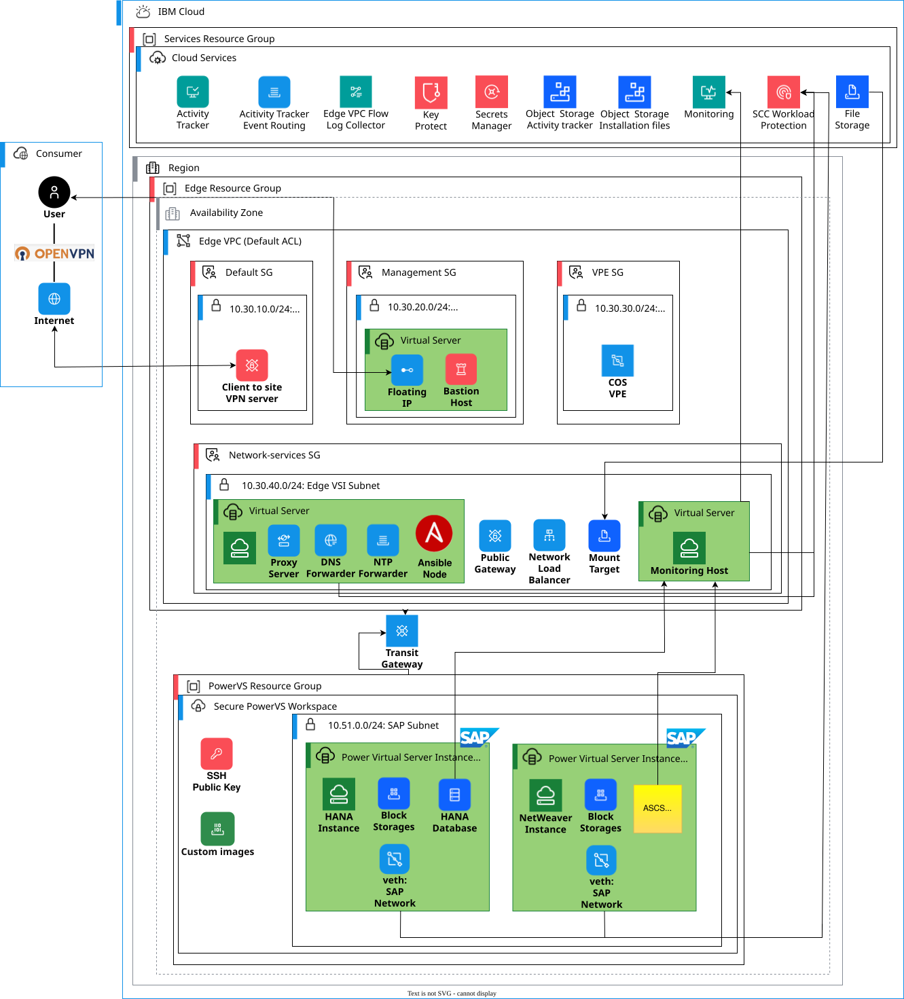

---
copyright:
  years: 2023, 2026
lastupdated: "2026-06-16"
keywords: SAP, {{site.data.keyword.cloud_notm}} SAP-Certified Infrastructure, {{site.data.keyword.ibm_cloud_sap}}, {{site.data.keyword.powerSys_notm}}, Infrastructure, Landing zone, VPC, deployment planning
subcollection: sap
---

{{site.data.keyword.attribute-definition-list}}

# Deploying infrastructure for SAP workloads on {{site.data.keyword.powerSys_notm}}
{: #powervs-infra-overview}

Learn how to plan and deploy the infrastructure components that are required to host SAP workloads on {{site.data.keyword.powerSysFull}}.
{: shortdesc}

## Architecture overview
{: #architecture}

The recommended architecture for SAP on {{site.data.keyword.powerSys_notm}} consists of two main infrastructure components:

{{site.data.keyword.vpc_full}} (VPC) landing zone
:   Provides management services including a bastion host, proxy, Network Time Protocol (NTP), Domain Name System (DNS), and Network File System (NFS) services. This component is deployed in {{site.data.keyword.vpc_short}} and serves as the entry point and management layer for your SAP landscape.

{{site.data.keyword.powerSys_notm}} workspace
:   Hosts the SAP workloads, including SAP HANA databases and SAP NetWeaver application servers. This component provides the compute, storage, and network resources for your SAP systems.

{: caption="Infrastructure architecture for SAP on {{site.data.keyword.powerSys_notm}}" caption-side="bottom"}

The two components are connected through {{site.data.keyword.tg_full}}, which enables secure communication between the VPC management services and the {{site.data.keyword.powerSys_notm}} workloads.

## Deployment workflow
{: #deployment-workflow}

The deployment process consists of the following phases:

1. **Planning and prerequisites**: Review requirements, design the network layout, and prepare the necessary resources
2. **VPC infrastructure deployment**: Set up the VPC landing zone with management services
3. **{{site.data.keyword.powerSys_notm}} infrastructure deployment**: Create the workspace, networks, and prepare for SAP instances
4. **SAP instance deployment**: Deploy and configure SAP HANA and SAP NetWeaver instances

## Prerequisites
{: #prereqs}

Before you begin the deployment, ensure that you meet the following prerequisites.

### Required permissions
{: #required-permissions}

You need sufficient {{site.data.keyword.iamlong}} (IAM) permissions to create and manage the following resources:

- Services from the {{site.data.keyword.cloud_notm}} catalog
- {{site.data.keyword.vpc_short}} services, virtual server instances, networks, network prefixes, storage volumes, SSH keys, and {{site.data.keyword.security-groups_full_reg}}
- {{site.data.keyword.powerSysShort}} services, virtual server instances, networks, storage volumes, and SSH keys
- {{site.data.keyword.dl_full}} and {{site.data.keyword.tg_full_notm}} connections
- {{site.data.keyword.cos_full_notm}} services and buckets

For more information about {{site.data.keyword.iamshort}} permissions, see [Managing IAM access for VPC Infrastructure Services](/docs/vpc?topic=vpc-iam-getting-started) and [Managing {{site.data.keyword.powerSys_notm}} IAM access](/docs/power-iaas?topic=power-iaas-managing-resources-and-users).

### SSH key preparation
{: #ssh-key-prep}

Create an SSH key pair that you can use to authenticate to all virtual server instances. This key is required to log in to both {{site.data.keyword.vpc_short}} and {{site.data.keyword.powerSys_notm}} instances.

For more information about creating SSH keys, see [SSH keys](/docs/vpc?topic=vpc-ssh-keys).

### SAP software in {{site.data.keyword.cos_full_notm}}
{: #sap-software-cos}

Upload your SAP software installation packages and SAP Maintenance Planner XML files to an {{site.data.keyword.cos_short}} bucket. You need the following information to configure access from your virtual server instances:

- {{site.data.keyword.cos_short}} endpoint URL
- {{site.data.keyword.cos_short}} bucket name
- {{site.data.keyword.cos_short}} HMAC access key
- {{site.data.keyword.cos_short}} HMAC secret access key

For more information, see [Getting started with {{site.data.keyword.cos_full_notm}}](/docs/cloud-object-storage?topic=cloud-object-storage-getting-started-cloud-object-storage) and [Service credentials](/docs/cloud-object-storage?topic=cloud-object-storage-service-credentials).

### Operating system selection
{: #os-selection}

Choose a Linux operating system for your deployments. For consistency and simplified operations management, use the same OS release for all hosts in your environment.

Supported operating systems for SAP workloads on {{site.data.keyword.powerSysShort}} include:
- Red Hat Enterprise Linux (RHEL) 8.4 or later
- SUSE Linux Enterprise Server (SLES) 15 SP3 or later
- AIX (for SAP application server only)

For detailed information about supported operating systems, see [OS for {{site.data.keyword.powerSys_notm}}](/docs/sap?topic=sap-plan-os-powervs).

## Network planning
{: #network-planning}

Proper network planning is critical for a successful deployment. Design the network layout carefully to prevent IP address conflicts between all subnets in the landscape.

### Network design principles
{: #network-design}

All IP address ranges in your subnets must be unique and must not overlap.
{: important}

Consider the following items when you design the network:
- IP address ranges for VPC subnets
- IP address ranges for {{site.data.keyword.powerSys_notm}} private networks
- IP address ranges in your on-premises environment, if you connect using {{site.data.keyword.dl_short}}

### Example network layout
{: #network-example}

The following table shows an example network layout for a typical SAP deployment:

| Service                             | Network purpose                                                                   | Example IP address range |
| ----------------------------------- | --------------------------------------------------------------------------------- | ------------------------ |
| Edge VPC                            | Private network for VPN server                                                    | 10.30.10.0/24            |
| Edge VPC                            | Management network for Bastion virtual server instance                            | 10.30.20.0/24            |
| Edge VPC                            | Private network for Cloud Object Storage VPEs                                     | 10.30.30.0/24            |
| Edge VPC                            | Private network for Network services VSI. This subnet has public gateway enabled. | 10.30.40.0/24            |
| {{site.data.keyword.powerSys_notm}} | SAP network                                                                       | 10.51.0.0/24             |
{: caption="Example private network IP address ranges" caption-side="bottom"}

Adjust these ranges based on your specific requirements and existing network infrastructure.

## Automation options
{: #automation-options}

IBM provides automated deployment solutions for SAP on {{site.data.keyword.powerSys_notm}}:

Deployable Architecture
:   A complete infrastructure solution that is available in the{{site.data.keyword.cloud_notm}} catalog. It automates deployment of the VPC landing zone and {{site.data.keyword.powerSys_notm}} workspace by using Terraform and Ansible.

For more information, see [Power Virtual Server for SAP HANA](/docs/sap-powervs).

## Next steps
{: #next-steps}

After you complete the planning and ensure that all prerequisites are met, proceed with the infrastructure deployment:

1. [Prepare {{site.data.keyword.vpc_short}} infrastructure for SAP workloads](/docs/sap?topic=sap-powervs-set-up-vpc-infrastructure): Deploy the VPC landing zone with management services
2. [Prepare {{site.data.keyword.powerSys_notm}} workspaces for SAP workloads](/docs/sap?topic=sap-powervs-set-up-power-infrastructure): Create and configure the {{site.data.keyword.powerSys_notm}} workspace
