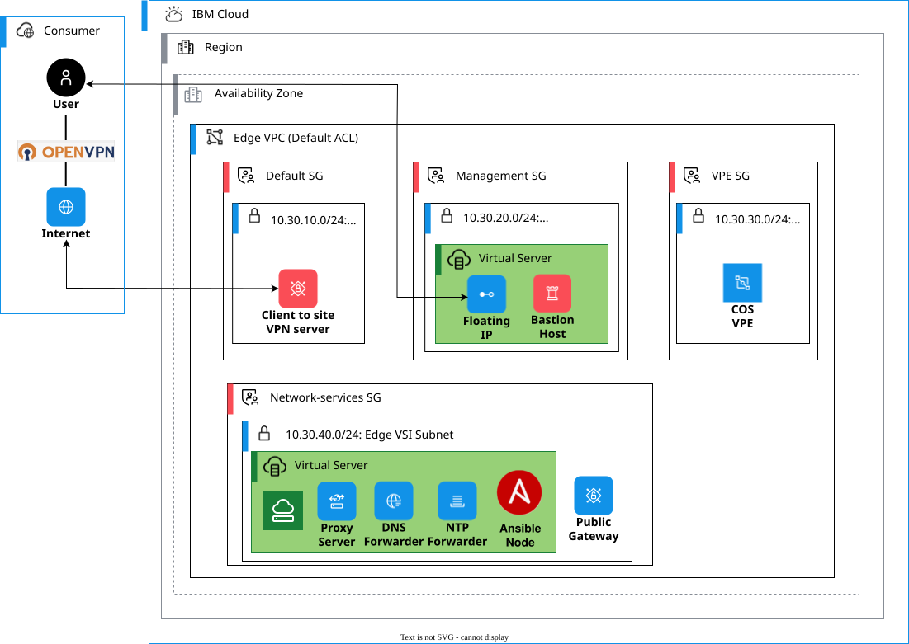

---
copyright:
  years: 2023, 2026
lastupdated: "2026-06-30"

keywords: SAP, {{site.data.keyword.cloud_notm}} SAP-Certified Infrastructure, {{site.data.keyword.ibm_cloud_sap}}, {{site.data.keyword.powerSys_notm}}, VPC, VPC landing zone, address prefix, subnet, security group, bastion host, access host, network services, SQUID proxy, NFS, NTP, DNS, VPE, Virtual Private Endpoint, Cloud Object Storage, floating IP, SSH, Ansible, chrony, BIND
subcollection: sap
content-type: tutorial
services: vpc, power-iaas
account-plan: paid
completion-time: 2h
---

{{site.data.keyword.attribute-definition-list}}


# Set up {{site.data.keyword.vpc_short}} landing zone infrastructure for SAP workloads
{: #powervs-set-up-vpc-infrastructure}
{: toc-content-type="tutorial"}
{: toc-services="vpc, power-iaas"}
{: toc-completion-time="2h"}

In this tutorial, you will learn how to set up the {{site.data.keyword.vpc_full}} (VPC) landing zone that provides management services for your SAP workloads on {{site.data.keyword.powerSysFull}}. You create a VPC, deploy virtual server instances for access and network services, and configure essential services including proxy, Network Time Protocol (NTP), and Domain Name System (DNS).
{: shortdesc}

The following figure shows the VPC landing zone for SAP on {{site.data.keyword.powerSys_notm}}.

{: caption="VPC landing zone architecture for SAP on {{site.data.keyword.powerSys_notm}}" caption-side="bottom"}

The VPC landing zone that you create has the following architecture:
1. A VPC with multiple subnets for different purposes (management, network services, and Virtual Private Endpoints (VPE)
1. An access host (bastion) that provides secure SSH access to the environment
1. A network services host that provides proxy, NTP, and DNS services
1. Security groups and ACLs that control traffic flow
1. A connection to {{site.data.keyword.powerSys_notm}} through {{site.data.keyword.tg_full_notm}} (configured in a later step)

## Before you begin
{: #vpc-prereqs}

Before you begin, ensure that you have:

* Completed the planning steps in [Deploying infrastructure for SAP workloads on {{site.data.keyword.powerSys_notm}}](/docs/sap?topic=sap-powervs-infra-overview)
* Sufficient {{site.data.keyword.iamlong}} (IAM) permissions to create and manage VPC resources
* An SSH key pair for authentication. For more information, see [SSH keys](/docs/vpc?topic=vpc-ssh-keys)
* A network design with non-overlapping IP address ranges for VPC subnets, {{site.data.keyword.powerSys_notm}} networks, and on-premises networks

## Create the VPC
{: #vpc-create-vpc}
{: step}

Create a {{site.data.keyword.vpc_short}} without default address prefixes to host the management services for your SAP landscape.

1. Log in to the [{{site.data.keyword.cloud_notm}} console](https://cloud.ibm.com){: external}.
1. Go to **VPC Infrastructure** > **VPCs**.
1. Click **Create**.
1. Enter a name for your VPC, such as `sap-management-vpc`.
1. Select a resource group.
1. Optionally, add tags for organization.
1. In the **Default address prefixes** section, clear the checkbox for **Create a default prefix for each zone** to prevent automatic creation of address prefixes.
1. Click **Create virtual private cloud**.

For detailed instructions, see [Creating a VPC and subnet](/docs/vpc?topic=vpc-creating-a-vpc-using-the-ibm-cloud-console#creating-a-vpc-and-subnet).

## Create address prefixes
{: #vpc-create-address-prefixes}
{: step}

Create address prefixes that define the IP address ranges for your VPC. These prefixes are used when creating subnets.

The following table shows the recommended address prefixes:

| Address prefix purpose | Example IP address range |
| ---------------------- | ------------------------ |
| VPN services           | 10.30.10.0/24            |
| Management services    | 10.30.20.0/24            |
| VPE services           | 10.30.30.0/24            |
| Network services       | 10.30.40.0/24            |
{: caption="Recommended address prefixes for VPC landing zone" caption-side="bottom"}

1. In your VPC details page, go to **Address prefixes**.
1. Click **Create**.
1. Create the first address prefix for VPN services:
   - Enter a name, such as `vpn-prefix`.
   - Select an availability zone.
   - Enter an IP address range, such as `10.30.10.0/24`.
   - Click **Create**.
1. Create the second address prefix for management services:
   - Enter a name, such as `management-prefix`.
   - Select an availability zone.
   - Enter an IP address range, such as `10.30.20.0/24`.
   - Click **Create**.
1. Create the third address prefix for VPE services:
   - Enter a name, such as `vpe-prefix`.
   - Select an availability zone.
   - Enter an IP address range, such as `10.30.30.0/24`.
   - Click **Create**.
1. Create the fourth address prefix for network services:
   - Enter a name, such as `network-services-prefix`.
   - Select an availability zone.
   - Enter an IP address range, such as `10.30.40.0/24`.
   - Click **Create**.

## Create subnets from address prefixes
{: #vpc-create-subnets}
{: step}

Create subnets from the address prefixes you created. You need at least three subnets: one for VPN server, one for the access host, and one for network services.

The following table shows the recommended subnet layout:

| Subnet name             | Address prefix          | IP address range | Public gateway | Purpose                                            |
| ----------------------- | ----------------------- | ---------------- | -------------- | -------------------------------------------------- |
| vpn-subnet              | vpn-prefix              | 10.30.10.0/24    | No             | VPN server                                         |
| management-subnet       | management-prefix       | 10.30.20.0/24    | No             | Bastion host (access host)                         |
| vpe-subnet              | vpe-prefix              | 10.30.30.0/24    | No             | Virtual Private Endpoints for Cloud Object Storage |
| network-services-subnet | network-services-prefix | 10.30.40.0/24    | Yes            | Network services host                              |
{: caption="Recommended subnet layout for VPC landing zone" caption-side="bottom"}

1. In your VPC details page, go to **Subnets**.
1. Click **Create**.
1. Create the VPN subnet from the VPN address prefix:
   - Enter a name, such as `vpn-subnet`.
   - Select the same availability zone as the VPN address prefix.
   - Select the address prefix `vpn-prefix` (10.30.10.0/24).
   - Leave the public gateway detached.
   - Click **Create subnet**
1. Create the management subnet from the management address prefix:
   - Enter a name, such as `management-subnet`.
   - Select the same availability zone as the management address prefix.
   - Select the address prefix `management-prefix` (10.30.20.0/24).
   - Leave the public gateway detached.
   - Click **Create subnet**
1. Create the VPE subnet from the VPE address prefix:
   - Enter a name, such as `vpe-subnet`.
   - Select the same availability zone as the VPE address prefix.
   - Select the address prefix `vpe-prefix` (10.30.30.0/24).
   - Leave the public gateway detached.
   - Click **Create subnet**.
1. Create the network services subnet from the network services address prefix:
   - Enter a name, such as `network-services-subnet`.
   - Select the same availability zone as the network services address prefix.
   - Select the address prefix `network-services-prefix` (10.30.40.0/24).
   - Attach a public gateway to enable internet access for software updates.
   - Click **Create subnet**.


## Configure security groups
{: #vpc-security-groups}
{: step}

Create security groups to control traffic to your virtual server instances, VPEs, and other resources. Security groups act as virtual firewalls that control inbound and outbound traffic.

### Security group overview
{: #vpc-sg-overview}

You need to create three security groups for the VPC landing zone:

1. **management-sg**: Controls access to the bastion host (access host). Allows SSH access from IBM Cloud infrastructure, VPC subnets, {{site.data.keyword.powerSys_notm}} networks, VPN client pool, and optionally from your trusted IP addresses.

1. **network-services-sg**: Controls access to the network services host. Allows all traffic from IBM Cloud infrastructure, VPC subnets, {{site.data.keyword.powerSys_notm}} networks, and VPN client pool.

1. **vpe-sg**: Controls access to Virtual Private Endpoints for Cloud Object Storage. Allows all traffic from IBM Cloud infrastructure, VPC subnets, {{site.data.keyword.powerSys_notm}} networks, and VPN client pool.

### Create security groups
{: #vpc-create-sg}

1. In your VPC details page, go to **Security groups**.
1. Click **Create**.
1. Create each security group according to the rules in the following table.

The following table shows the security group rules for the VPC landing zone:

| Security group name | Inbound rules | Outbound rules | Attached resources |
| ------------------- | ------------- | -------------- | ------------------ |
| management-sg | **Source:** IBM Cloud infrastructure (161.26.0.0/16) \n **Protocol:** TCP, **Port:** 22 \n \n **Source:** VPC address prefixes (10.30.20.0/24, 10.30.30.0/24, 10.30.40.0/24) \n **Protocol:** All \n \n **Source:** {{site.data.keyword.powerSys_notm}} management network \n **Protocol:** TCP, **Port:** 22 \n \n **Source:** VPN client IP pool (if using VPN) \n **Protocol:** TCP, **Port:** 22 \n \n **Source:** Your trusted IP addresses (optional) \n **Protocol:** TCP, **Port:** 22 | **Destination:** Any \n **Protocol:** All | Access host (bastion) virtual server instance |
| network-services-sg | **Source:** IBM Cloud infrastructure (161.26.0.0/16) \n **Protocol:** All \n \n **Source:** VPC address prefixes (10.30.20.0/24, 10.30.30.0/24, 10.30.40.0/24) \n **Protocol:** All \n \n **Source:** {{site.data.keyword.powerSys_notm}} management network \n **Protocol:** All \n \n **Source:** {{site.data.keyword.powerSys_notm}} backup network \n **Protocol:** All \n \n **Source:** VPN client IP pool (if using VPN) \n **Protocol:** All | **Destination:** Any \n **Protocol:** All | Network services virtual server instance, load balancer, file share mount targets |
| vpe-sg | **Source:** IBM Cloud infrastructure (161.26.0.0/16) \n **Protocol:** All \n \n **Source:** VPC address prefixes (10.30.20.0/24, 10.30.30.0/24, 10.30.40.0/24) \n **Protocol:** All \n \n **Source:** {{site.data.keyword.powerSys_notm}} management network \n **Protocol:** All \n \n **Source:** {{site.data.keyword.powerSys_notm}} backup network \n **Protocol:** All \n \n **Source:** VPN client IP pool (if using VPN) \n **Protocol:** All | **Destination:** Any \n **Protocol:** All | Virtual Private Endpoints for Cloud Object Storage |
{: caption="Security group rules for VPC landing zone" caption-side="bottom"}

Replace the example IP address ranges with your actual network CIDRs: VPC address prefixes (for example, 10.30.10.0/24, 10.30.20.0/24, 10.30.30.0/24, 10.30.40.0/24), {{site.data.keyword.powerSys_notm}} management network CIDR (for example, 10.51.0.0/24), {{site.data.keyword.powerSys_notm}} backup network CIDR (for example, 10.52.0.0/24), and VPN client IP pool CIDR if you're using VPN (for example, 10.240.0.0/24).
{: important}

For more information, see [Configuring the security group for the instance](/docs/vpc?topic=vpc-creating-a-vpc-using-the-ibm-cloud-console#configuring-the-security-group-step).

## Deploy the bastion or access host
{: #vpc-deploy-access-host}
{: step}

Create a virtual server instance that serves as the access host (bastion) for your SAP landscape.

1. Go to **VPC Infrastructure** > **Virtual server instances**.
1. Click **Create**.
1. Configure the virtual server instance:
   - Enter a name, such as `sap-access-host`.
   - Select your VPC.
   - Select the management subnet.
   - Select a Linux operating system image (RHEL 8.4 or later, or SLES 15 SP3 or later).
   - Select the smallest profile (for example, `nxf-1x2`)
   - Add your SSH key.
1. In the **Network interfaces** section, click **Edit** on the primary network interface:
   - Deselect the default security group.
   - Select the `management-sg` security group.
   - Click **Save**.
1. Click **Create virtual server instance**.
1. Wait for the instance status to change to **Running**.

## Enable floating IP for bastion or access host
{: #vpc-floating-ip}
{: step}

Reserve and attach a floating IP address to the access host to enable external SSH access.

1. In the access host instance details page, go to **Network interfaces**.
1. Click **Reserve** next to Floating IP.
1. Configure the floating IP:
   - Enter a name, such as `access-host-fip`.
   - Click **Reserve**.
1. Note the floating IP address for SSH access.

For more information, see [Reserving a floating IP address](/docs/vpc?topic=vpc-creating-a-vpc-using-the-ibm-cloud-console#reserving-a-floating-ip-address).

## Verify access to the bastion/access host
{: #vpc-verify-access}
{: step}

Test SSH access to the access host using the floating IP address.

1. Open a terminal on your local machine.
1. Run the following SSH command (replace `<access_host_floating_ip>` with your floating IP address):

   ```bash
   ssh -A -o ServerAliveInterval=60 -o ServerAliveCountMax=600 root@<access_host_floating_ip>
   ```
   {: pre}

1. Verify that you can successfully log in to the access host.

The `ServerAliveInterval` and `ServerAliveCountMax` parameters help maintain a stable SSH connection.
{: tip}

## Deploy the network services host
{: #vpc-deploy-network-services}
{: step}

Create a virtual server instance that provides essential network services to {{site.data.keyword.powerSys_notm}} instances.

1. Go to **VPC Infrastructure** > **Virtual server instances**.
1. Click **Create**.
1. Configure the virtual server instance:
   - Enter a name, such as `sap-network-services`.
   - Select your VPC.
   - Select the network services subnet.
   - Select a Linux operating system image (RHEL 9.4 or later).
   - Select a profile with at least 2 vCPUs and 4 GB memory.
   - Add your SSH key.
1. In the **Network interfaces** section, click **Edit** on the primary network interface:
   - Deselect the default security group.
   - Select the `network-services-sg` security group.
   - Click **Save**.
1. Click **Create virtual server instance**.
1. Wait for the instance status to change to **Running**.

## Verify access to the network services host
{: #vpc-verify-network-services}
{: step}

Test SSH access to the network services host through the access host.

1. Open a terminal on your local machine.
1. Run the following SSH command (replace `<access_host_floating_ip>` and `<network_services_host_private_ip>` with your IP addresses):

   ```bash
   ssh -A -o ServerAliveInterval=60 -o ServerAliveCountMax=600 -o ProxyCommand="ssh -W %h:%p root@<access_host_floating_ip>" root@<network_services_host_private_ip>
   ```
   {: pre}

1. Verify that you can successfully log in to the network services host.

## Create Virtual Private Endpoint for {{site.data.keyword.cos_full_notm}}
{: #vpc-create-vpe-cos}
{: step}

Create a Virtual Private Endpoint (VPE) for {{site.data.keyword.cos_full_notm}} to enable secure, private access to Cloud Object Storage from your VPC and {{site.data.keyword.powerSys_notm}} instances.

1. In the {{site.data.keyword.cloud_notm}} console, go to **VPC Infrastructure** > **Virtual private endpoints**.
1. Click **Create**.
1. Configure the VPE gateway:
   - Enter a name, such as `cos-vpe`.
   - Select your VPC.
   - Select your resource group.
1. In the **Service** section:
   - For **Service category**, select **Cloud Object Storage**.
   - For **Service offering**, select **Cloud Object Storage**.
   - The service endpoint will be automatically populated.
1. In the **Reserved IP** section:
   - Click **Attach** to attach a reserved IP.
   - Select the `vpe-subnet` that you created earlier.
   - Select **Auto-assign** to automatically assign an IP address from the subnet.
   - Click **Attach**.
1. In the **Security groups** section:
   - Deselect the default security group.
   - Select the `vpe-sg` security group that you created earlier.
1. Click **Create virtual private endpoint**.
1. Wait for the VPE status to change to **Stable**.
1. Note the reserved IP address assigned to the VPE. This IP address will be used to access Cloud Object Storage from your {{site.data.keyword.powerSys_notm}} instances.

For more information about Virtual Private Endpoints, see [About Virtual Private Endpoints for VPC](/docs/vpc?topic=vpc-about-vpe).

## Configure SQUID proxy server
{: #vpc-configure-squid}
{: step}

Configure the SQUID proxy server to enable {{site.data.keyword.powerSys_notm}} instances to access the internet for software updates and package installations.

You can use the `ibm.power_linux_sap` Ansible collection to automate this configuration. For more information, see the Ansible automation section at the end of this tutorial.

1. Log in to the network services host using the SSH command from the previous step.
1. Install SQUID:
     ```bash
     yum update -y && yum install -y squid
     ```
     {: pre}

1. Replace the contents of `/etc/squid/squid.conf` with the contents from [SQUID configuration file](https://github.com/IBM/ansible-power-linux-sap/blob/main/roles/configure_network_management_services/files/squid.conf){: external}.
1. Enable and start the SQUID service:
   ```bash
   systemctl enable squid
   systemctl restart squid
   systemctl status squid
   ```
   {: pre}


## Configure NTP service
{: #vpc-configure-ntp}
{: step}

Configure the NTP service to ensure time synchronization across all systems in your SAP landscape.

1. Log in to the network services host.
1. Install chrony:
     ```bash
     yum update -y && yum install -y chrony
     ```
     {: pre}

1. Edit `/etc/chrony.conf` and add the following lines (replace `<pvs_mgmt_cidr>` with your {{site.data.keyword.powerSys_notm}} management network CIDR, such as `10.51.0.0/24`):
   ```text
   local stratum 10
   manual
   allow <pvs_mgmt_cidr>
   ```
   {: codeblock}

1. Enable and start the chrony service:
   ```bash
   systemctl enable chronyd
   systemctl start chronyd
   systemctl status chronyd
   ```
   {: pre}

## Configure DNS services
{: #vpc-configure-dns}
{: step}

Configure DNS services for name resolution. You can choose between using IBM Cloud DNS service or configuring a DNS forwarder.

### Option 1: Using IBM Cloud DNS service (recommended)
{: #vpc-dns-cloud-service}

IBM Cloud DNS service is directly reachable from {{site.data.keyword.powerSys_notm}} instances through a custom resolver.

1. Create a DNS service instance. For more information, see [Setting up an instance](/docs/dns-svcs?topic=dns-svcs-setting-up-your-dns-instance).
1. Create DNS zones. For more information, see [Managing DNS zones](/docs/dns-svcs?topic=dns-svcs-managing-dns-zones&interface=ui).
1. Configure permitted networks. For more information, see [Managing permitted networks](/docs/dns-svcs?topic=dns-svcs-managing-permitted-networks&interface=ui).
1. Create DNS records. For more information, see [Managing DNS records](/docs/dns-svcs?topic=dns-svcs-managing-dns-records).
1. Configure a custom resolver with the VPE subnet as the location. For more information, see [Configuring custom resolver](/docs/dns-svcs?topic=dns-svcs-ui-create-cr).

The custom resolver provides private IP addresses that you can specify in {{site.data.keyword.powerSys_notm}} subnet configurations.

### Option 2: Configuring DNS forwarder
{: #vpc-dns-forwarder}

If you use your own DNS service, configure a DNS forwarder on the network services host.

1. Log in to the network services host.
1. Install BIND:
     ```bash
     yum update -y && yum install -y bind
     ```
     {: pre}

1. Edit `/etc/named.conf`:
   - Add the following ACL at the beginning (replace `<pvs_mgmt_cidr>` with your {{site.data.keyword.powerSys_notm}} management network CIDR):
     ```text
     acl allowed_clients {
       localhost;
       <pvs_mgmt_cidr>;
     };
     ```
     {: codeblock}

   - Add the following lines in the `options` section:
     ```text
     forwarders {
       161.26.0.7;
       161.26.0.8;
       9.9.9.9;
     };
     recursion yes;
     allow-query { allowed_clients; };
     forward only;
     ```
     {: codeblock}

1. Enable and start the DNS service:
   ```bash
   systemctl enable named
   systemctl restart named
   systemctl status named
   ```
   {: pre}

## Automate with Ansible (optional)
{: #vpc-ansible-automation}

You can automate the configuration of network services using the `ibm.power_linux_sap` Ansible collection.

1. Install the Ansible collection:
   ```bash
   ansible-galaxy collection install ibm.power_linux_sap
   ```
   {: pre}

1. Update the variable file `playbook/vars/sample-variables-configure-network-services-host.yml`:
   ```yaml
   server_config: {
     squid: { enable: true },
     ntp: { enable: true },
     dns: { enable: true, dns_servers: "161.26.0.7; 161.26.0.8; 9.9.9.9;" }
   }
   ```
   {: codeblock}

1. Run the Ansible playbook:
   ```bash
   ansible-playbook --connection=local -i "localhost," playbooks/sample-configure-network-services-host.yml
   ```
   {: pre}

## Next steps
{: #vpc-next-steps}

After you complete the VPC infrastructure setup, proceed with creating the {{site.data.keyword.powerSys_notm}} workspace:

* [Preparing {{site.data.keyword.powerSys_notm}} workspaces for SAP workloads](/docs/sap?topic=sap-powervs-set-up-power-infrastructure)

Alternatively, you can use the automated Deployable Architecture solution available in the {{site.data.keyword.cloud_notm}} catalog to deploy the complete VPC landing zone using Terraform and Ansible. For more information, see [Deploying the VPC landing zone for {{site.data.keyword.powerSys_notm}}](/docs/powervs-vpc?topic=powervs-vpc-deploy-arch-ibm-pvs-inf-standard).
