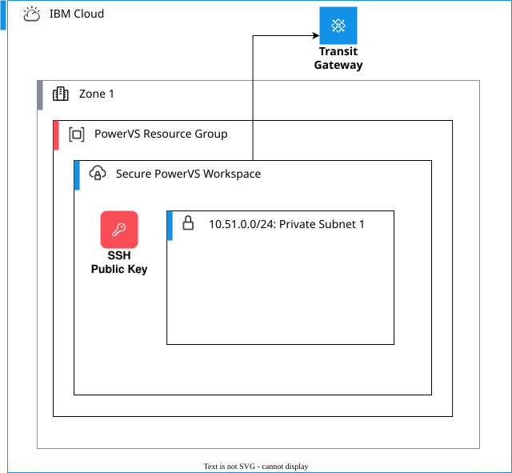

---
copyright:
  years: 2020, 2026
lastupdated: "2026-06-30"
keywords: SAP, {{site.data.keyword.cloud_notm}} SAP-Certified Infrastructure, {{site.data.keyword.ibm_cloud_sap}}, SAP Workloads, {{site.data.keyword.powerSys_notm}} Workspace, SSH Key, Transit Gateway, {{site.data.keyword.powerSys_notm}} Subnets, Networks, Network security groups, Network address groups
subcollection: sap
content-type: tutorial
services: power-iaas
account-plan: paid
completion-time: 1h
---

{{site.data.keyword.attribute-definition-list}}


# Preparing IBM {{site.data.keyword.powerSys_notm}} workspaces for SAP workloads
{: #powervs-set-up-power-infrastructure}
{: toc-content-type="tutorial"}
{: toc-services="power-iaas"}
{: toc-completion-time="1h"}

In this tutorial, you will learn how to create and configure an {{site.data.keyword.powerSysFull}} workspace to host SAP workloads. This workspace provides the compute, network, and storage resources for your SAP HANA databases and SAP NetWeaver application servers.
{: shortdesc}

{: caption="{{site.data.keyword.powerSys_notm}} infrastructure for SAP" caption-side="bottom"}

## Before you begin
{: #workspace-prereqs}

Before you create a {{site.data.keyword.powerSys_notm}} workspace, ensure that you meet the following prerequisites:

- You have an {{site.data.keyword.cloud_notm}} account with the permissions required to create {{site.data.keyword.powerSys_notm}} resources
- You completed the [VPC infrastructure setup](/docs/sap?topic=sap-powervs-set-up-vpc-infrastructure) for management services
- You have an SSH key pair ready for authentication to virtual server instances
- You planned your network layout to avoid IP address conflicts between VPC and {{site.data.keyword.powerSys_notm}} subnets

## Understanding {{site.data.keyword.powerSys_notm}} workspaces
{: #workspace-overview}

A {{site.data.keyword.powerSys_notm}} workspace is a regional environment that provides compute, network, and storage resources. Resources that you create in a workspace are isolated to that workspace. You cannot move or share these resources with other workspaces. Each workspace is associated with a single data center.

Deploy all SAP HANA and SAP application server instances within the designated {{site.data.keyword.powerSys_notm}} workspace. The workspace connects to your VPC management services through {{site.data.keyword.tg_full_notm}}, which enables secure communication between the two environments.

### Colocated regions
{: #colocated-regions}

Create the {{site.data.keyword.powerSys_notm}} workspace in the same region as your IBM Cloud edge VPC. {{site.data.keyword.powerSys_notm}} data centers are colocated with VPC regions to enable low-latency connectivity through {{site.data.keyword.tg_full}}.
{: important}

For the most current list of colocated regions and data centers, see [Colocation of {{site.data.keyword.powerSys_notm}} and VPC](/docs/power-iaas?topic=power-iaas-ibm-cloud-reg){: external}.

## Create a {{site.data.keyword.powerSys_notm}} workspace
{: #create-workspace}
{: step}

Create a workspace in the same region as your VPC infrastructure.

1. Log in to the [{{site.data.keyword.cloud_notm}} console](https://cloud.ibm.com){: external}.
1. Navigate to **Catalog** > **Compute** > **{{site.data.keyword.powerSys_notm}}**.
1. Click **Create**.
1. Enter a unique name for your workspace.
1. Select the resource group where you want to create the workspace.
1. Select the region and data center location that matches your VPC region.
1. Review the pricing information.
1. Click **Create** to provision the workspace.

Creating the workspace takes a few minutes. After the workspace is created, you can access it from the {{site.data.keyword.powerSys_notm}} dashboard.

For more information, see [Creating a {{site.data.keyword.powerSys_notm}} workspace](/docs/power-iaas?topic=power-iaas-creating-power-virtual-server#creating-service){: external}.

## Create an SSH key
{: #create-ssh-key}
{: step}

Create an SSH key in your workspace to authenticate to virtual server instances.

1. Open the {{site.data.keyword.powerSys_notm}} console and select your workspace.
1. In the navigation menu, click **SSH keys** under **Compute** section.
1. Click **Create SSH key**.
1. Enter a unique name for the SSH key.
1. Select the access level:
   - **Account level**: The key is visible across all workspaces in your account (traditional approach).
   - **Workspace level**: The key is restricted to this workspace only. This option is recommended for isolation.
1. Optional: Add a description for the key.
1. Paste your SSH public key in the **SSH key** field.
1. Click **Add SSH key**.

SSH keys can exist at either the account level or the workspace level. Workspace-scoped keys provide isolation between environments and are restricted to a single workspace. This approach is recommended for production environments.
{: note}

## Create a private network subnet
{: #create-subnets}
{: step}

Create a private network subnet for your SAP workloads.

1. In your {{site.data.keyword.powerSys_notm}} workspace, click **Subnets** in the navigation menu.
1. Click **Create subnet**.
1. Configure the subnet:
   - In the **Name** field, enter `sap-net`.
   - In the **CIDR notation** field, enter the subnet range, for example, `10.51.0.0/24`.
   - Select **Private** as the subnet type.
   - Set **MTU** to **9000** to use jumbo frames for optimal performance.
   - Click **Create subnet**.

Always configure subnets with MTU 9000 to use jumbo frames for SAP workloads. This setting provides optimal network performance and is required for SAP HANA deployments.
{: important}

Ensure that the IP address range for the {{site.data.keyword.powerSys_notm}} subnet does not overlap with your VPC subnets or on-premises networks.
{: important}

For more information, see [Configuring and adding a private network subnet](/docs/power-iaas?topic=power-iaas-configuring-subnet){: external}.

## Connect workspace to {{site.data.keyword.tg_full_notm}}
{: #connect-transit-gateway}
{: step}

Connect your {{site.data.keyword.powerSys_notm}} workspace to the {{site.data.keyword.tg_full_notm}} to enable communication with VPC management services.

1. Navigate to **Interconnectivity** > **{{site.data.keyword.tg_full_notm}}** in the {{site.data.keyword.cloud_notm}} console.
1. Select your existing {{site.data.keyword.tg_full_notm}} that was created during VPC setup, or create a new one.
1. Click **Add connection**.
1. Select **{{site.data.keyword.powerSys_notm}}** as the network connection type.
1. Select your region.
1. Select your {{site.data.keyword.powerSys_notm}} workspace from the list.
1. Enter a name for the connection.
1. Click **Add** to create the connection.

The connection may take a few minutes to become active. After the connection is established, you can ping the {{site.data.keyword.powerSys_notm}} private network IP addresses from the access host that is deployed in VPC.

For more information, see [Adding a connection](/docs/transit-gateway?topic=transit-gateway-adding-connections&interface=ui){: external}.

## Verify connectivity
{: #verify-connectivity}
{: step}

Verify that you can reach the {{site.data.keyword.powerSys_notm}} subnets from your VPC access host.

1. Log in to your VPC access host:

   ```bash
   ssh -A -o ServerAliveInterval=60 -o ServerAliveCountMax=600 root@<access_host_floating_ip>
   ```
   {: pre}

1. Ping an IP address in your {{site.data.keyword.powerSys_notm}} management subnet:

   ```bash
   ping <powervs_subnet_ip>
   ```
   {: pre}

1. If the ping is successful, the {{site.data.keyword.tg_short}} connection is working correctly.

If you cannot reach the {{site.data.keyword.powerSys_notm}} subnets, verify that the Transit Gateway connection is in **Available** state and that the subnets are configured correctly .
{: tip}

## Optional: Configure network security groups
{: #configure-nsg}
{: step}

Network security groups provide an additional layer of security for your {{site.data.keyword.powerSys_notm}} instances by controlling inbound and outbound traffic at the instance level. Network security groups are similar to security groups in VPC but are specific to {{site.data.keyword.powerSys_notm}}.

### Understanding network security groups
{: #nsg-overview}

Network security groups allow you to do the following tasks:
- Control traffic to and from individual {{site.data.keyword.powerSys_notm}} instances
- Define rules based on IP addresses, ports, and protocols
- Apply different security policies to different instances in the same subnet
- Enhance security by implementing defense-in-depth strategies

### Create a {{site.data.keyword.networksecuritygroups_full}}
{: #create-nsg}

1. In your {{site.data.keyword.powerSys_notm}} workspace, click **Network security groups** in the navigation menu.
1. Click **Create network security group**.
1. Enter a name for the security group, for example, `sap-hana-nsg`.
1. Optional: Add a description.
1. Click **Create**.

### Add rules to a {{site.data.keyword.networksecuritygroups_short}}
{: #add-nsg-rules}

After you create the {{site.data.keyword.networksecuritygroups_short}}, add inbound and outbound rules to control traffic.

1. Select the network security group that you created.
1. In the **Inbound rules** section, click **Add rule**.
1. Configure the rule:
   - **Protocol**: Select TCP, UDP, ICMP, or All.
   - **Port range**: Specify the port or port range, for example, `22` for SSH, `3200-3299` for SAP.
   - **Source**: Enter the source IP address or CIDR block.
   - **Description**: Add a description for the rule.
1. Click **Add** to create the rule.
1. Repeat these steps to add additional inbound rules.
1. Add outbound rules by following the same process in the **Outbound rules** section.

Example rules for SAP HANA:

| Direction | Protocol | Port range | Source or destination | Description |
| --------- | -------- | ---------- | ------------------ | ----------- |
| Inbound | TCP | 22 | 10.30.20.0/24 | SSH from VPC management subnet |
| Inbound | TCP | 3200-3299 | 10.51.0.0/24 | SAP instance communication |
| Inbound | TCP | 30013-30015 | 10.51.0.0/24 | SAP HANA database ports |
| Outbound | All | All | 0.0.0.0/0 | Allow all outbound traffic |
{: caption="Example {{site.data.keyword.networksecuritygroups_short}} rules for SAP HANA" caption-side="bottom"}

## Optional: Configure network address groups
{: #configure-nag}
{: step}

Network address groups simplify the management of network security group rules by allowing you to group IP addresses and CIDR blocks into reusable objects. Instead of specifying individual IP addresses in each rule, you can reference a network address group.

### Understanding network address groups
{: #nag-overview}

Network address groups provide the following benefits:
- Simplify network security group rule management by grouping related IP addresses
- Enable reuse of address groups across multiple network security group rules
- Simplify updates to security policies by modifying the network address groups instead of individual rules
- Improve readability of security rules by using descriptive group names

### Create a network address group
{: #create-nag}

1. In your {{site.data.keyword.powerSys_notm}} workspace, click **Network address groups** in the navigation menu.
1. Click **Create network address group**.
1. Enter a name for the address group, for example, `vpc-management-hosts`.
1. Optional: Add a description.
1. Add IP addresses or CIDR blocks:
   - Click **Add address**.
   - Enter an IP address or CIDR block, for example, `10.30.20.0/24`.
   - Optional: Add a description for the address.
   - Click **Add**
1. Repeat these steps to add more addresses to the group.
1. Click **Create** to save the network address group.

### Use network address groups in network security group rules
{: #use-nag}

After you create a network address group, you can reference it in your network security group rules.

1. Navigate to **Network security groups** in your workspace.
1. Select the network security group where you want to use the network address group.
1. Click **Add rule**.
1. Configure the rule:
   - **Protocol**: Select the protocol.
   - **Port range**: Specify the port or port range.
   - **Source type**: Select **Network address group**.
   - **Source**: Select the network address group from the dropdown list.
   - **Description**: Add a description.
1. Click **Add** to create the rule.

Example network address groups for SAP environments:

| Network address group name | IP addresses or CIDR blocks | Purpose |
| -------- | ------------------------ | ------- |
| `vpc-management-hosts` | 10.30.20.0/24 | VPC management subnet for SSH access |
| `sap-application-servers` | 10.51.0.10, 10.51.0.11, 10.51.0.12 | SAP application server instances |
| `sap-hana-databases` | 10.51.0.20, 10.51.0.21 | SAP HANA database instances |
| `backup-servers` | 10.40.20.0/24 | Backup network subnet |
{: caption="Example network address groups for SAP environments" caption-side="bottom"}

For more information, see [Network address groups](/docs/power-iaas?topic=power-iaas-network-address-groups){: external}.

## Next steps
{: #workspace-next-steps}

After you complete the {{site.data.keyword.powerSys_notm}} workspace setup, you can proceed with deploying SAP instances:

- [Deploy {{site.data.keyword.powerSys_notm}} instances for SAP workloads](/docs/sap?topic=sap-powervs-set-up-power-instances)

## Terraform automation
{: #workspace-automation}

Terraform automates all the preceding steps. The automation is available as a [Deployable Architecture](https://cloud.ibm.com/catalog/7a4d68b4-cf8b-40cd-a3d1-f49aff526eb3/architecture/deploy-arch-ibm-pvs-ws-standard-e0d3c2e7-7849-480e-bcf0-6e2a96009031-global?catalog_query=aHR0cHM6Ly9jbG91ZC5pYm0uY29tL2NhdGFsb2cjZGVwbG95YWJsZV9hcmNoaXRlY3R1cmVfdGFi){: external} solution in the {{site.data.keyword.cloud_notm}} catalog.

For more information, see GitHub repository solution [Power Virtual Server Workspace](https://github.com/terraform-ibm-modules/terraform-ibm-powervs-workspace/tree/main/solutions/standard){: external}.
