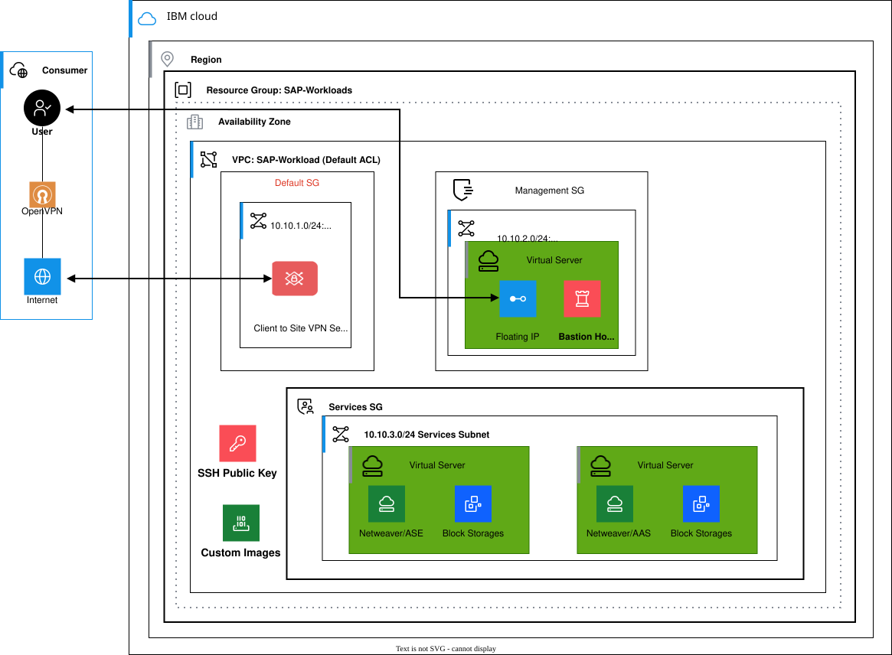

---
copyright:
  years: 2026
lastupdated: "2026-10-15"
keywords:
subcollection: sap
---

{{site.data.keyword.attribute-definition-list}}

# Overview of SAP NetWeaver 7.5 with ASE
{: #overview-sap-ase}

SAP NetWeaver 7.5 solution uses Adaptive Server Enterprise (ASE) Sybase as the underlying database and Red Hat&reg; Enterprise Linux&reg; 9.4 operating system in the {{site.data.keyword.vpc_short}} environment. The configuration refers to a 2-tier installation where the SAP Application layer and the ASE Sybase database layer are running on the same underlying virtual server instance (VSI) as part of the IaaS offering within the {{site.data.keyword.vpc_short}} environment.
{: shortdesc}

The supported database version for this configuration is **ASE 16 SP04 PL06**. Both the SAP application and database components run on RHEL 9.4, providing a certified and optimized operating environment.

{: caption="Architecture Diagram - SAP NetWeaver 7.5 with ASE Sybase" caption-side="bottom"}

The deployment includes the following phases:

1. [Cloud infrastructure planning](/docs/sap?topic=sap-deploy-sap-ase-intro#cloud-infra-plan-ase)
2. [Cloud resource deployment](/docs/sap?topic=sap-deploy-sap-ase-intro#cloud-resource-deploy-ase)
3. [File system preparation](/docs/sap?topic=sap-deploy-sap-ase-intro#file-system-prep-ase)
4. [Operating system preparation](/docs/sap?topic=sap-deploy-sap-ase-intro#os-prep-ase)
5. [Installation of SAP NetWeaver 7.5 with ASE with Software Provisioning Manager (SWPM)](/docs/sap?topic=sap-deploy-sap-ase-intro#install-sapnw-ase)
